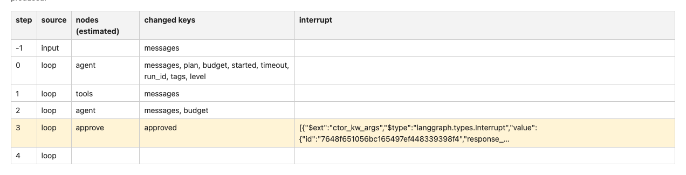
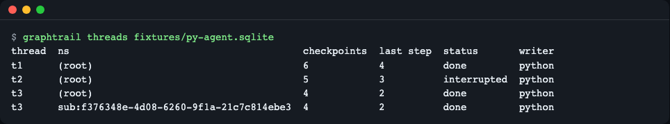
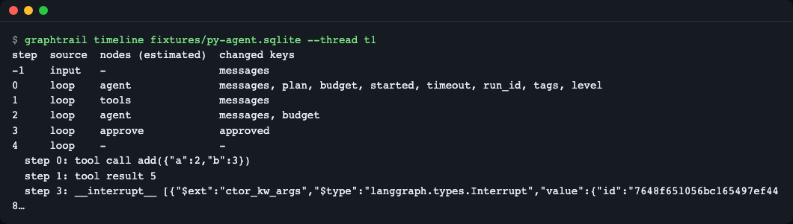
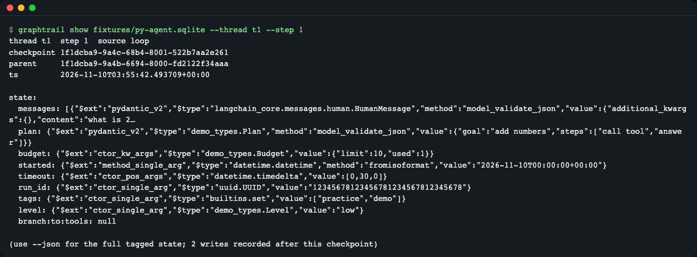
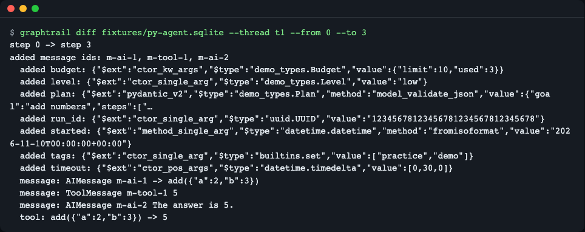
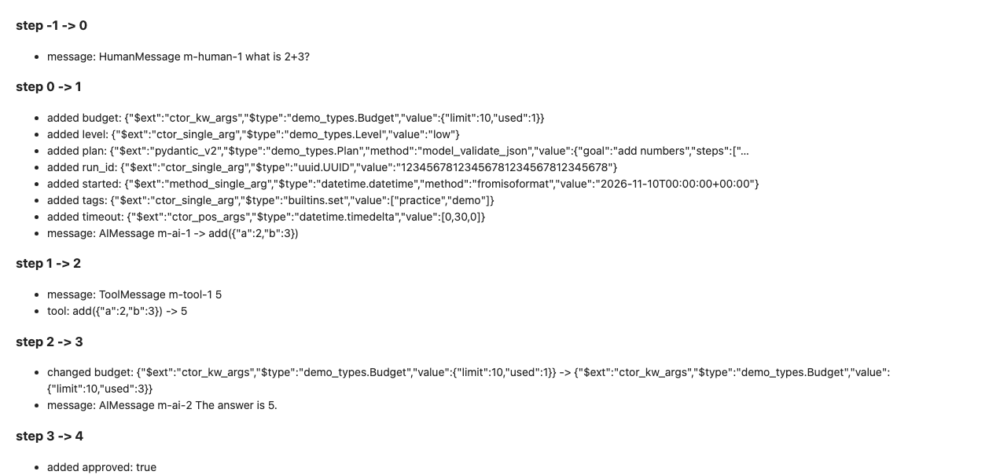
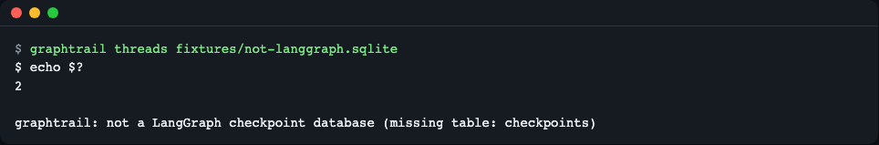
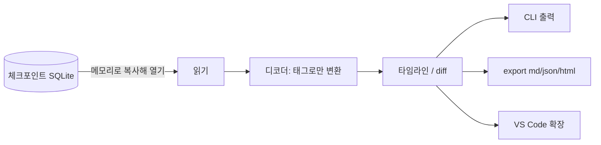

# graphtrail

[English](README.md) | **한국어**

LangGraph 에이전트가 남긴 체크포인트 DB(SQLite 파일 하나)를 그래프 코드나 개발 서버 없이 열어서, 스레드별 실행 이력과 단계별 상태 차이를 보여 주는 읽기 전용 도구입니다.


*`graphtrail export --format html` 로 만든 리포트의 타임라인. 샘플 스레드 t1 의 단계, 추정 노드, 바뀐 키가 한 표에 모입니다.*

## 무엇을 더해 주나요

- **스레드 목록과 상태**: 어떤 스레드가 끝났는지(`done`), 사람 입력을 기다리는지(`interrupted`)를 한눈에 봅니다.
- **타임라인 재구성**: `parent_checkpoint_id` 를 따라 단계 순서로 정렬하고, 단계마다 바뀐 키·도구 호출·결과·interrupt 를 보여 줍니다.
- **단계 비교(diff)**: 두 단계 사이에 추가된 메시지, 바뀐 값, "도구 호출 → 결과" 쌍을 보여 줍니다.
- **코드 실행 없이 해석**: Python 이 저장한 msgpack 확장 타입과 JS 가 저장한 JSON 을 "태그"로만 읽습니다. 모듈을 불러오거나 객체를 만들지 않습니다.
- **내보내기**: JSON·Markdown·HTML(자체 완결형)로 저장해 이슈·PR 에 첨부할 수 있습니다.

> 용어 풀이 — **체크포인트**: 그래프가 한 단계를 끝낼 때마다 저장하는 전체 상태 스냅샷. **스레드**: 하나의 대화·실행(`thread_id`). **interrupt**: 사람의 입력을 받으려고 실행을 멈춘 지점. **msgpack**: JSON 과 비슷하지만 바이너리인 직렬화 형식.

## 요구 사항

> 지원 범위(읽을 수 있는 DB·미지원 항목)는 아래 표의 "읽을 수 있는 DB" 행과 [자주 겪는 문제](#자주-겪는-문제), [docs/format.md](docs/format.md) 에 있습니다. 샘플 DB 에 대한 설명은 [사용법](#사용법) 첫 단락에 있습니다.

| 호스트 | 확인한 버전 | 비고 |
|---|---|---|
| Node.js (CLI) | 26.13.0, `package.json` 은 `>=22.18` 요구 | CI 는 Node 22 와 최신 LTS 에서 돌립니다 |
| npm | 11.20.0 | tarball 설치 확인 |
| VS Code (확장) | **실제 VS Code 에서는 확인하지 못함** | `engines.vscode` 는 `^1.90.0`. 아래 "VS Code 확장" 참고 |
| 읽을 수 있는 DB | Python `langgraph-checkpoint-sqlite` 3.1.3, JS `@langchain/langgraph-checkpoint-sqlite` 1.1.0 로 만든 샘플 | 2026-11-10 기준. Postgres 는 미지원 |

Node.js 가 없다면 <https://nodejs.org/> 에서 설치합니다(macOS: `brew install node`, Debian/Ubuntu: `sudo apt-get install -y nodejs npm` 은 버전이 낮을 수 있으니 22 이상인지 `node --version` 으로 확인).

## 설치

권장 방법은 **tarball 설치**입니다. 레지스트리(npm)에는 아직 올리지 않았습니다.

```bash
git clone https://github.com/LeeGyeongPil/graphtrail.git
cd graphtrail
npm ci            # 개발 의존성 설치
npm pack          # graphtrail-0.1.3.tgz 생성 (dist/ 는 이미 커밋되어 있어 빌드가 필요 없음)
npm install -g ./graphtrail-0.1.3.tgz
graphtrail --version
```

```text
0.1.3
```

릴리스 페이지에 `graphtrail-0.1.3.tgz` 가 올라와 있으면 `npm install -g ./graphtrail-0.1.3.tgz` 한 줄이면 됩니다. 전역 설치가 싫다면 설치 없이 `node dist/cli.js <명령>` 으로도 같은 일을 합니다(예시의 `graphtrail` 을 `node dist/cli.js` 로 바꿔 실행하면 됩니다). `npm ci` 때 esbuild·@vscode/vsce-sign 설치 스크립트 경고가 보일 수 있으나 무시해도 됩니다(CLI 의 런타임 의존성은 `sql.js`, `@msgpack/msgpack` 두 개뿐입니다).

> **알려진 한계**: `npm install -g git+https://github.com/LeeGyeongPil/graphtrail.git` 처럼 git URL 로 **전역** 설치하면 npm 11.20.0 에서 실패했습니다(전역 폴더가 설치 후 지워지는 임시 클론으로의 심볼릭 링크가 되어 `graphtrail` 실행 파일이 끊어짐). 같은 git URL 을 프로젝트 로컬(`npm install git+https://...`)로 설치하거나 tarball 로 설치하면 동작합니다. npm 버전에 따라 다를 수 있습니다.

### VS Code 확장

```bash
npm run vsix      # vscode/graphtrail-vscode-0.1.3.vsix 생성
code --install-extension vscode/graphtrail-vscode-0.1.3.vsix
```

> **정직하게**: 확장은 `.vsix` 패키징, 매니페스트 검사, 타입 검사까지만 자동 테스트로 확인했습니다. **실제 VS Code 에서 설치해 열어 본 적은 없습니다.** 확장 호스트에서의 동작(커스텀 에디터 표시, 트리 뷰)은 검증되지 않았으니, 써 보고 문제가 있으면 이슈로 알려 주세요. 위 `code --install-extension` 명령도 직접 실행해 보지 못했습니다. 핵심 기능은 CLI 로 확인되어 있습니다.

## 사용법

예시에 쓰는 `fixtures/py-agent.sqlite` 는 **연습용 샘플**입니다. 실제 LangGraph 라이브러리로 그래프를 돌려 만들었지만, 모델은 정해진 답을 내놓는 **연습용 목(mock) 모델**입니다. 실제 모델 호출 결과가 아니며 키도 필요 없습니다. 이 도구는 파일만 읽으므로 "실제 모드"가 따로 없고, 자신의 DB 경로만 바꿔 넣으면 같은 방식으로 동작합니다.

### 1. 스레드 목록 — `threads`

```bash
graphtrail threads fixtures/py-agent.sqlite
```

```text
thread  ns                                        checkpoints  last step  status       writer
t1      (root)                                    6            4          done         python
t2      (root)                                    5            3          interrupted  python
t3      (root)                                    4            2          done         python
t3      sub:f376348e-4d08-6260-9f1a-21c7c814ebe3  4            2          done         python
```


*스레드 4줄. t2 는 interrupt 로 멈춰 있고, t3 는 서브그래프(`sub:...`)가 별도 줄로 나옵니다.*

무슨 뜻인지: `ns` 가 `(root)` 면 최상위 그래프이고, `sub:...` 는 서브그래프 이력입니다. `writer` 는 DB 를 쓴 쪽(Python 이면 msgpack, JS 면 JSON)입니다. `--json` 을 붙이면 같은 내용을 JSON 으로 줍니다.

### 2. 타임라인 — `timeline`

```bash
graphtrail timeline fixtures/py-agent.sqlite --thread t1
```

```text
step  source  nodes (estimated)  changed keys
-1    input   -                  messages
0     loop    agent              messages, plan, budget, started, timeout, run_id, tags, level
1     loop    tools              messages
2     loop    agent              messages, budget
3     loop    approve            approved
4     loop    -                  -
  step 0: tool call add({"a":2,"b":3})
  step 1: tool result 5
  step 3: __interrupt__ [{"$ext":"ctor_kw_args","$type":"langgraph.types.Interrupt","value":{"id":"7648f651056bc165497ef448…
```


*t1 의 입력과 5단계(step -1~4). agent 가 도구를 부르고(step 0), tools 가 5 를 돌려주고(step 1), approve 에서 interrupt 가 걸립니다(step 3).*

무슨 뜻인지: 한 행은 "이 체크포인트에서 시작해 다음 체크포인트까지 실행된 한 단계"입니다. `nodes` 는 그 단계에서 실행된 노드, `changed keys` 는 그 단계가 바꾼 상태 키(이 체크포인트와 다음 체크포인트의 차이)이므로 두 열이 같은 시점을 가리킵니다. 예: step 1 행은 `tools` 가 `messages` 만 바꿨다는 뜻입니다. 마지막 행은 다음 체크포인트가 없어 `changed keys` 가 `-` 입니다(`nodes` 는 `-` 이거나, interrupt 로 멈춘 스레드라면 값이 들어갑니다). 예를 들어 interrupted 스레드 t2 의 마지막 행(step 3)은 `nodes` 가 `agent, tools, approve` 로 나옵니다. 이 열은 `versions_seen` 으로 추정한 노드 이름 전체이므로, 대기 중인 노드가 `approve` 하나여도 지금까지 움직인 노드가 함께 보일 수 있습니다. `step -1` 은 입력, 이후는 그래프가 한 번 돌 때마다 하나씩입니다. **노드 이름은 DB 에 저장되지 않습니다.** 다음 체크포인트의 `versions_seen` 이 움직인 노드를 보고 추정하므로 열 이름에 `(estimated)` 가 붙습니다. 서브그래프는 `--ns sub:<id>` 로 봅니다. 스레드가 하나뿐인 DB 는 `--thread` 를 생략할 수 있고, 여럿이면 종료 코드 2 와 함께 스레드 목록을 알려 줍니다. 없는 스레드·네임스페이스를 줘도 종료 코드 2 와 안내 메시지가 나옵니다(`show`·`diff`·`export` 와 같음).

### 3. 한 단계의 상태 — `show`

```bash
graphtrail show fixtures/py-agent.sqlite --thread t1 --step 1
```


*step 1 의 상태. `$type`/`$ext` 는 "저장된 값이 이런 파이썬 타입의 이런 방식 생성"이라는 표시일 뿐, 실제 객체는 만들어지지 않았습니다.*

`--id <체크포인트 id 앞부분>` 으로도 고를 수 있고, `--json` 은 줄임 없이 전체 상태를 줍니다.

### 4. 두 단계 비교 — `diff`

```bash
graphtrail diff fixtures/py-agent.sqlite --thread t1 --from 0 --to 3
```


*step 0 에서 step 3 까지: 추가된 메시지 3개와 `tool: add({"a":2,"b":3}) -> 5` 쌍이 보입니다.*

### 5. 내보내기 — `export`

```bash
graphtrail export fixtures/py-agent.sqlite --thread t1 --format md > t1.md
graphtrail export fixtures/py-agent.sqlite --thread t1 --format html > t1.html
```

`--format` 은 `json`·`md`·`html` 이고 결과는 표준 출력으로 나옵니다. 같은 입력이면 같은 출력이 나오도록 만들었습니다(순서·시각 고정). HTML 은 외부 파일을 읽지 않는 한 파일이며, 엄격한 콘텐츠 보안 정책(CSP)이 들어 있고 상태 값은 이스케이프됩니다.


*HTML 리포트의 "Steps"(단계별 변화) 영역.*

### 6. LangGraph DB 가 아닐 때

```bash
graphtrail threads fixtures/not-langgraph.sqlite
```

```text
graphtrail: not a LangGraph checkpoint database (missing table: checkpoints)
```

```bash
echo $?
```

```text
2
```


*다른 SQLite 파일은 거절합니다. 오류 메시지가 먼저 나오고, 이어 `echo $?` 로 확인하면 종료 코드 2 가 나옵니다(이미지는 두 출력의 줄 순서가 실제와 다르게 담겼습니다).*

### 종료 코드

| 코드 | 뜻 |
|---|---|
| 0 | 정상 |
| 2 | LangGraph 체크포인트 DB 가 아니거나, 인자가 잘못됨(없는 스레드·단계·읽을 수 없는 파일 경로 포함) |
| 1 | 그 밖의 오류 |

### VS Code 안에서 (미검증)

설계상 `*.sqlite`·`*.sqlite3`·`*.db` 파일을 "graphtrail checkpoint viewer" 로 열 수 있고(우선순위 `option` 이라 기본 열기 방식은 바뀌지 않음), 명령 팔레트에 `graphtrail: Open Checkpoint Database` 가 추가됩니다. 데이터베이스가 열리면 탐색기에 스레드 트리가 나타납니다. 위에서 밝혔듯 실제 VS Code 에서는 확인하지 못했습니다.

## 설정

설정 항목은 없습니다. 동작은 명령줄 옵션으로만 바뀝니다.

| 옵션 | 기본값 | 설명 |
|---|---|---|
| `--thread ID` | 스레드가 하나면 그 스레드 | 읽을 스레드 |
| `--ns NS` | 루트 그래프 | 서브그래프 네임스페이스 |
| `--step N` / `--id PREFIX` | - | `show` 에서 단계 또는 체크포인트 지정 |
| `--from` / `--to` | - | `diff` 의 비교 구간(단계 번호 또는 체크포인트 id 앞부분) |
| `--json` | 꺼짐 | `threads`·`timeline`·`show`·`diff` 를 JSON 으로 출력 |
| `--format` | - | `export` 형식: `json`·`md`·`html` |

## 동작 원리



1. **메모리로 복사해 열기**: SQLite 는 WASM 판(sql.js)으로, 파일을 읽어 메모리에서만 엽니다. 옆에 `<db>-wal` 파일이 있으면 아직 체크포인트되지 않은 그 커밋분도 메모리 사본에 반영합니다. 원본 파일과 `-wal` 은 읽기만 하고 `-shm` 은 건드리지 않으며, 모두 바뀌지 않습니다(테스트가 해시로 확인).
2. **디코더**: Python 은 msgpack 확장 타입 0~7 에 "모듈·클래스·인자"를 담아 저장합니다. 라이브러리로 읽으면 그 모듈을 불러와 생성자를 호출하므로, 출처를 모르는 파일은 위험합니다. graphtrail 은 이 정보를 `{"$type": ..., "$ext": ..., "value": ...}` 로만 출력합니다. 알 수 없는 확장 타입과 `pickle` 은 내용을 해석하지 않고 크기만 보고합니다. 위험의 근거: JSON 모드 역직렬화 사례 [CVE-2025-64439](https://nvd.nist.gov/vuln/detail/CVE-2025-64439), msgpack 역직렬화 사례 [CVE-2026-28277](https://github.com/advisories/GHSA-g48c-2wqr-h844) (확인 2026-11-10 기준 조사 기록).
3. **타임라인**: `parent_checkpoint_id` 사슬을 따라 정렬하고, 노드는 `versions_seen` 으로 추정합니다.
4. **껍데기**: CLI 와 VS Code 확장은 같은 코어를 부르는 얇은 층입니다.

권한과 네트워크: 네트워크에 접속하지 않고, 파일은 인자로 준 DB(와 옆의 `-wal`)만 읽습니다. 출력 외에 쓰는 파일이 없습니다. 저장 형식 상세는 [docs/format.md](docs/format.md).

## 자주 겪는 문제

| 증상 | 원인 | 해결 |
|---|---|---|
| `--thread is required; this database has 3 threads` | DB 에 스레드가 여러 개 | 안내된 목록에서 `--thread t1` 처럼 지정 |
| `not a LangGraph checkpoint database` | `checkpoints` 테이블이 없는 파일 | 올바른 DB 경로인지, `SqliteSaver` 로 만든 파일인지 확인 |
| 노드 열이 `-` (또는 interrupted 스레드 마지막 행에 `agent, tools, approve` 처럼 여러 개) | 마지막 단계이거나 대기 노드를 알 수 없음. interrupt 로 멈춘 스레드는 추정 노드가 여러 개 보일 수 있음 | 정상입니다. 노드 이름은 저장되지 않고 추정만 합니다 |
| 분기(fork)가 있는 스레드에서 일부 이력이 안 보임 | 가장 새 잎의 사슬만 보여 줌 | 경고가 출력됩니다. 분기 트리는 아직 미구현 |
| 일부 값이 `delta_snapshot` 표식으로만 보임 | 델타 채널(msgpack 확장 타입 7)을 쓰는 그래프 | 값 재구성은 아직 미구현. 표식만 보입니다 |
| 실행 중인 앱의 최신 체크포인트가 안 보임(DB 옆에 `<db>-wal` 파일이 있음) | `SqliteSaver` 는 WAL 모드라 SQLite 가 체크포인트하기 전까지 최신 기록이 `-wal` 에 있음 | 0.1.3 부터 `-wal` 의 커밋된 기록을 읽기만 해서 반영하고 CLI 는 `warning:` 한 줄을 알립니다. 원본은 그대로 |
| Postgres 저장소를 열 수 없음 | SQLite 만 지원 | 이후 버전 과제 |
| `npm install -g git+...` 뒤 `graphtrail: command not found` | npm 11.20.0 의 git 전역 설치 문제 | tarball 로 설치 |

`-wal` 처리를 직접 확인하려면 저장소에 든 픽스처로 실행해 보세요(본 파일에는 `t1` 만 있고 나머지는 옆의 `-wal` 에 있습니다). `warning:` 줄은 stderr 로 나가고 종료 코드는 0 입니다.

```text
$ graphtrail threads fixtures/wal-agent.sqlite
warning: included 1 committed transaction(s) from fixtures/wal-agent.sqlite-wal that are not yet checkpointed
thread  ns                                        checkpoints  last step  status       writer
t1      (root)                                    6            4          done         python
t2      (root)                                    5            3          interrupted  python
t3      (root)                                    4            2          done         python
t3      sub:f376348e-4d08-6260-9f1a-21c7c814ebe3  4            2          done         python
```

알려진 한계: VS Code 확장도 `-wal` 을 반영하지만 `warning:` 줄은 화면에 보여 주지 않습니다(CLI 는 보여 줍니다).

## 개발·기여

```bash
git clone https://github.com/LeeGyeongPil/graphtrail.git
cd graphtrail
npm ci
npm test        # 빌드 + 단위·CLI 테스트 + .vsix 패키징 (오프라인, Python 불필요)
```

샘플 DB 를 다시 만드는 스크립트는 `fixtures/gen/` 에 있습니다. `dist/` 는 커밋되어 있으며 CI 가 소스와 같은지 확인합니다. 변경 기록은 [CHANGELOG.md](CHANGELOG.md), 취약점 신고는 [SECURITY.md](SECURITY.md).

## 더 알아보기

- LangGraph 영속성(체크포인터) 문서: <https://docs.langchain.com/oss/python/langgraph/persistence> (확인 2026-11-10 기준 조사 기록)
- 저장 형식과 확장 타입 표, 체크포인트 구조(`checkpoints`·`writes` 테이블, 사슬, interrupt), 지원 범위와 한계: [docs/format.md](docs/format.md)

## 라이선스

MIT.
