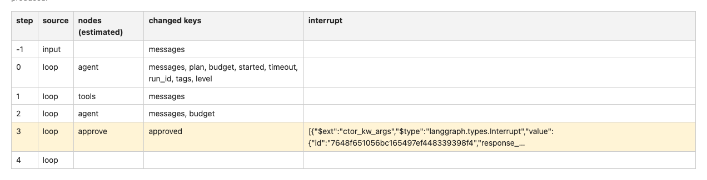
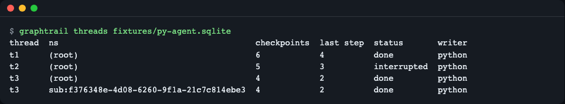
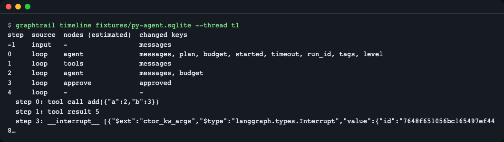
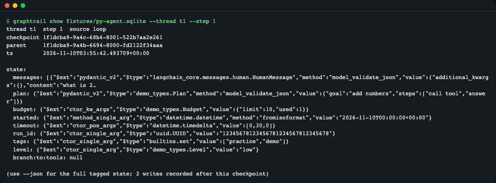
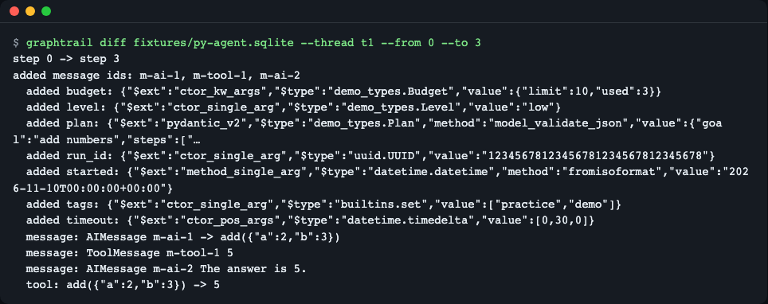
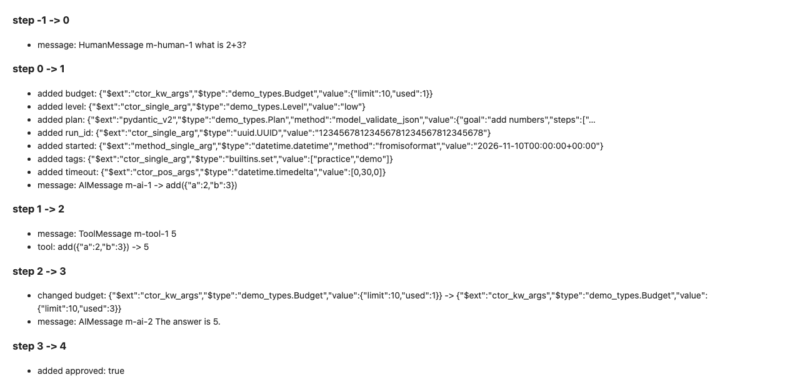
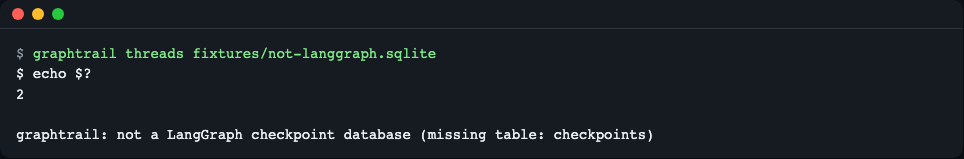
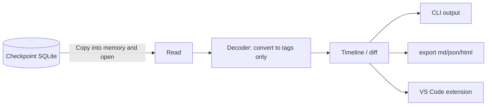

# graphtrail

**English** | [한국어](README.ko.md)

graphtrail opens a LangGraph `SqliteSaver` checkpoint database (Python or JS, a single SQLite file) from the command line or from a read-only VS Code extension, without the graph code or a dev server. It rebuilds each thread's timeline, shows state diffs between steps and interrupts, and never imports or runs any code found in the file. Install: `npm pack && npm install -g ./graphtrail-0.1.2.tgz`.


*The timeline of a report made with `graphtrail export --format html`. The steps, estimated nodes, and changed keys of the sample thread t1 come together in one table.*

## What it adds

- **Thread list and status**: See at a glance which threads are finished (`done`) and which are waiting for human input (`interrupted`).
- **Timeline reconstruction**: Sorts into step order by following `parent_checkpoint_id`, and shows, for each step, the changed keys, tool calls, results, and interrupts.
- **Step comparison (diff)**: Shows the messages added between two steps, the changed values, and the "tool call → result" pairs.
- **Interpretation without running code**: Reads the msgpack extension types stored by Python and the JSON stored by JS only as "tags." It never imports a module or constructs an object.
- **Export**: Save as JSON, Markdown, or HTML (self-contained) to attach to an issue or PR.

> Glossary — **Checkpoint**: a snapshot of the whole state that the graph saves each time it finishes a step. **Thread**: one conversation or run (`thread_id`). **interrupt**: a point where execution stops to take human input. **msgpack**: a binary serialization format similar to JSON.

## Requirements

> The supported scope (which DBs can be read and what is unsupported) is in the "DBs it can read" row of the table below, in [Troubleshooting](#troubleshooting), and in [docs/format.md](docs/format.md). The explanation of the sample DB is in the first paragraph of [Usage](#usage).

| Host | Version checked | Notes |
|---|---|---|
| Node.js (CLI) | 26.13.0; `package.json` requires `>=22.18` | CI runs on Node 22 and the latest LTS |
| npm | 11.20.0 | tarball install confirmed |
| VS Code (extension) | **Not confirmed in a real VS Code** | `engines.vscode` is `^1.90.0`. See "VS Code extension" below |
| DBs it can read | Samples made with Python `langgraph-checkpoint-sqlite` 3.1.3 and JS `@langchain/langgraph-checkpoint-sqlite` 1.1.0 | As of 2026-11-10. Postgres is unsupported |

If you don't have Node.js, install it from <https://nodejs.org/> (macOS: `brew install node`; Debian/Ubuntu: `sudo apt-get install -y nodejs npm` may give an old version, so check with `node --version` that it is 22 or later).

## Install

The recommended method is the **tarball install**. It has not been uploaded to the registry (npm) yet.

```bash
git clone https://github.com/LeeGyeongPil/graphtrail.git
cd graphtrail
npm ci            # Install dev dependencies
npm pack          # Creates graphtrail-0.1.2.tgz (dist/ is already committed, so no build is needed)
npm install -g ./graphtrail-0.1.2.tgz
graphtrail --version
```

```text
0.1.2
```

If `graphtrail-0.1.2.tgz` is on the releases page, the single line `npm install -g ./graphtrail-0.1.2.tgz` is enough. If you don't like a global install, `node dist/cli.js <command>` does the same thing without installing (replace `graphtrail` in the examples with `node dist/cli.js`). During `npm ci` you may see install-script warnings from esbuild and @vscode/vsce-sign, but you can ignore them (the CLI's runtime dependencies are just two: `sql.js` and `@msgpack/msgpack`).

> **Known limitation**: A **global** install by git URL such as `npm install -g git+https://github.com/LeeGyeongPil/graphtrail.git` failed on npm 11.20.0 (the global folder becomes a symlink to a temporary clone that is deleted after install, so the `graphtrail` executable breaks). Installing the same git URL project-locally (`npm install git+https://...`) or installing by tarball works. It may differ by npm version.

### VS Code extension

```bash
npm run vsix      # Creates vscode/graphtrail-vscode-0.1.2.vsix
code --install-extension vscode/graphtrail-vscode-0.1.2.vsix
```

> **To be honest**: For the extension, only `.vsix` packaging, the manifest check, and the type check were confirmed by automated tests. **We have never installed and opened it in a real VS Code.** Behavior in the extension host (the custom editor display, the tree view) is unverified, so if you try it and hit a problem, please tell us in an issue. We have not run the `code --install-extension` command above ourselves either. The core features are confirmed through the CLI.

## Usage

The `fixtures/py-agent.sqlite` used in the examples is a **practice sample**. It was made by running a graph with the real LangGraph library, but the model is a **practice mock model** that gives fixed answers. It is not the result of a real model call, and no key is needed. This tool only reads files, so there is no separate "real mode"; just swap in your own DB path and it works the same way.

### 1. Thread list — `threads`

```bash
graphtrail threads fixtures/py-agent.sqlite
```

```text
thread  ns                                        checkpoints  last step  status       writer
t1      (root)                                    6            4          done         python
t2      (root)                                    5            3          interrupted  python
t3      (root)                                    4            2          done         python
t3      sub:f376348e-4d08-6260-9f1a-21c7c814ebe3  4            2          done         python
```


*Four thread lines. t2 is stopped by an interrupt, and t3's subgraph (`sub:...`) appears on a separate line.*

What it means: if `ns` is `(root)`, it is the top-level graph, and `sub:...` is a subgraph's history. `writer` is the side that wrote the DB (msgpack if Python, JSON if JS). Add `--json` to get the same content as JSON.

### 2. Timeline — `timeline`

```bash
graphtrail timeline fixtures/py-agent.sqlite --thread t1
```

```text
step  source  nodes (estimated)  changed keys
-1    input   -                  messages
0     loop    agent              messages, plan, budget, started, timeout, run_id, tags, level
1     loop    tools              messages
2     loop    agent              messages, budget
3     loop    approve            approved
4     loop    -                  -
  step 0: tool call add({"a":2,"b":3})
  step 1: tool result 5
  step 3: __interrupt__ [{"$ext":"ctor_kw_args","$type":"langgraph.types.Interrupt","value":{"id":"7648f651056bc165497ef448…
```


*The input and 5 steps (step -1 to 4) of t1. The agent calls a tool (step 0), tools returns 5 (step 1), and an interrupt is raised at approve (step 3).*

What it means: one row is "one step that ran, starting at this checkpoint and ending at the next." `nodes` is the nodes that ran in that step, and `changed keys` is the state keys that step changed (the difference between this checkpoint and the next), so the two columns point to the same moment. Example: the step 1 row means `tools` changed only `messages`. The last row has no next checkpoint, so `changed keys` is `-` (`nodes` is `-`, or, for a thread stopped by an interrupt, has a value). For example, in the last row (step 3) of the interrupted thread t2, `nodes` shows `agent, tools, approve`. This column is the full set of node names estimated from `versions_seen`, so even when the waiting node is just `approve`, the nodes that have moved so far may appear together. `step -1` is the input, and after that there is one per run of the graph. **Node names are not stored in the DB.** They are estimated from the nodes that moved in the next checkpoint's `versions_seen`, which is why the column name carries `(estimated)`. View a subgraph with `--ns sub:<id>`. For a DB with only one thread you can omit `--thread`, and with several it gives exit code 2 together with the thread list. Giving a non-existent thread or namespace also gives exit code 2 and a guidance message (the same for `show`, `diff`, and `export`).

### 3. State at one step — `show`

```bash
graphtrail show fixtures/py-agent.sqlite --thread t1 --step 1
```


*The state at step 1. `$type`/`$ext` is only a marker meaning "the stored value was created this way, of this Python type"; no actual object was created.*

You can also pick with `--id <start of checkpoint id>`, and `--json` gives the full state without abbreviation.

### 4. Comparing two steps — `diff`

```bash
graphtrail diff fixtures/py-agent.sqlite --thread t1 --from 0 --to 3
```


*From step 0 to step 3: 3 added messages and the pair `tool: add({"a":2,"b":3}) -> 5` are shown.*

### 5. Export — `export`

```bash
graphtrail export fixtures/py-agent.sqlite --thread t1 --format md > t1.md
graphtrail export fixtures/py-agent.sqlite --thread t1 --format html > t1.html
```

`--format` is `json`, `md`, or `html`, and the result goes to standard output. It is built so that the same input gives the same output (order and timestamps fixed). The HTML is a single file that reads no external files, carries a strict content security policy (CSP), and has its state values escaped.


*The "Steps" (changes per step) area of the HTML report.*

### 6. When it is not a LangGraph DB

```bash
graphtrail threads fixtures/not-langgraph.sqlite
```

```text
graphtrail: not a LangGraph checkpoint database (missing table: checkpoints)
```

```bash
echo $?
```

```text
2
```


*Other SQLite files are rejected. The error message appears first, and then checking with `echo $?` gives exit code 2 (in the image, the line order of the two outputs is captured differently from the real one).*

### Exit codes

| Code | Meaning |
|---|---|
| 0 | Normal |
| 2 | Not a LangGraph checkpoint DB, or the arguments are wrong (including a non-existent thread or step, or an unreadable file path) |
| 1 | Any other error |

### Inside VS Code (unverified)

By design, `*.sqlite`, `*.sqlite3`, and `*.db` files can be opened with the "graphtrail checkpoint viewer" (its priority is `option`, so the default way of opening does not change), and `graphtrail: Open Checkpoint Database` is added to the command palette. When a database is open, a thread tree appears in the explorer. As stated above, we have not confirmed this in a real VS Code.

## Settings

There are no settings. Behavior changes only through command-line options.

| Option | Default | Description |
|---|---|---|
| `--thread ID` | The thread, if there is only one | The thread to read |
| `--ns NS` | The root graph | Subgraph namespace |
| `--step N` / `--id PREFIX` | - | Specify a step or checkpoint in `show` |
| `--from` / `--to` | - | The comparison range of `diff` (step numbers or the start of checkpoint ids) |
| `--json` | Off | Output `threads`, `timeline`, `show`, `diff` as JSON |
| `--format` | - | `export` format: `json`, `md`, `html` |

## How it works



1. **Copy into memory and open**: SQLite is the WASM build (sql.js); it reads the file and opens it only in memory. The original file does not change (a test confirms this with a hash).
2. **Decoder**: Python stores "module, class, arguments" in msgpack extension types 0 to 7. Reading with the library imports that module and calls the constructor, so a file of unknown origin is dangerous. graphtrail outputs this information only as `{"$type": ..., "$ext": ..., "value": ...}`. For unknown extension types and `pickle`, it does not interpret the content and only reports the size. Basis for the danger: a JSON-mode deserialization case, [CVE-2025-64439](https://nvd.nist.gov/vuln/detail/CVE-2025-64439), and a msgpack deserialization case, [CVE-2026-28277](https://github.com/advisories/GHSA-g48c-2wqr-h844) (research record as of 2026-11-10).
3. **Timeline**: Sorts by following the `parent_checkpoint_id` chain, and estimates nodes from `versions_seen`.
4. **Shells**: The CLI and the VS Code extension are thin layers that call the same core.

Permissions and network: it does not connect to the network and reads only the DB given as an argument. It writes no files besides its output. For storage format details, see [docs/format.md](docs/format.md).

## Troubleshooting

| Symptom | Cause | Fix |
|---|---|---|
| `--thread is required; this database has 3 threads` | The DB has several threads | Specify one from the list shown, like `--thread t1` |
| `not a LangGraph checkpoint database` | A file with no `checkpoints` table | Check that it is the right DB path and a file made by `SqliteSaver` |
| The node column is `-` (or several, such as `agent, tools, approve`, in the last row of an interrupted thread) | It is the last step or the waiting node is unknown. A thread stopped by an interrupt can show several estimated nodes | Normal. Node names are not stored and are only estimated |
| Some history is missing in a thread with a fork | Only the chain of the newest leaf is shown | A warning is printed. The fork tree is not implemented yet |
| Some values appear only as a `delta_snapshot` marker | A graph that uses a delta channel (msgpack extension type 7) | Reconstructing the values is not implemented yet. Only the marker is shown |
| A Postgres store cannot be opened | Only SQLite is supported | A task for a later version |
| `graphtrail: command not found` after `npm install -g git+...` | The git global install problem in npm 11.20.0 | Install by tarball |

## Development and contributing

```bash
git clone https://github.com/LeeGyeongPil/graphtrail.git
cd graphtrail
npm ci
npm test        # Build + unit and CLI tests + .vsix packaging (offline, no Python needed)
```

The scripts that regenerate the sample DB are in `fixtures/gen/`. `dist/` is committed, and CI checks that it matches the source. The change log is [CHANGELOG.md](CHANGELOG.md), and for vulnerability reports see [SECURITY.md](SECURITY.md).

## Learn more

- LangGraph persistence (checkpointer) docs: <https://docs.langchain.com/oss/python/langgraph/persistence> (research record as of 2026-11-10)
- Storage format and the extension type table, checkpoint structure (the `checkpoints` and `writes` tables, chains, interrupts), supported scope and limits: [docs/format.md](docs/format.md)

## License

MIT.
